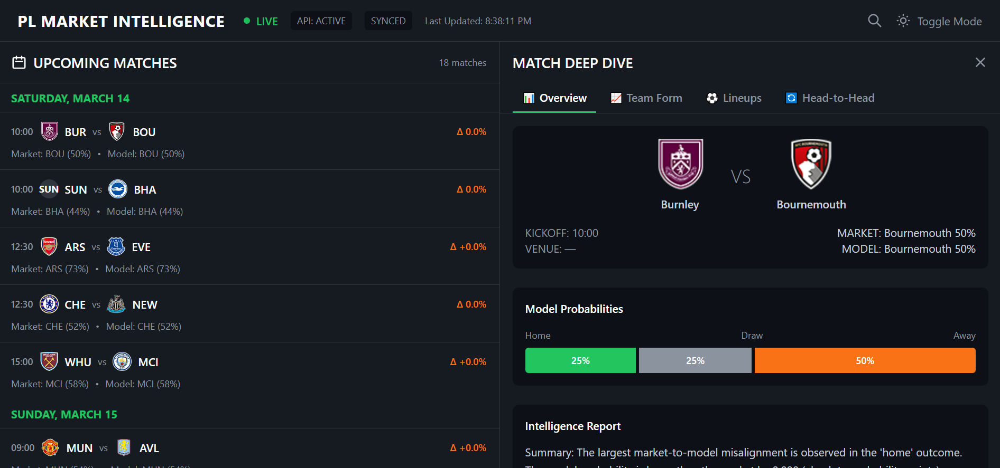

# Premier League Intelligence

A full-stack football analytics project that combines match data, a trained
probability model, and prospective result tracking. The React dashboard compares
home/draw/away model probabilities with normalized bookmaker probabilities.

[Hosted dashboard](https://pl-analysis.vercel.app/) ·
[Architecture](docs/ARCHITECTURE.md) · [Model design](docs/MODEL.md) ·
[Deployment runbook](docs/DEPLOYMENT.md) · [Training commands](backend/prediction/README.md)

The hosted dashboard may lag the repository until its deployments complete.
Generative match explanations are planned; the current predictions use classical
machine learning, not an LLM or a Hugging Face model.



*The screenshot predates the learned prediction and tracking panels.*

## What is implemented

- React + TypeScript dashboard with match selection, recent form, lineup context,
  head-to-head history, dark/light themes and browser caching.
- FastAPI integration with The Odds API and API-Football. Upcoming fixtures and
  market odds come from The Odds API; supplementary match context uses API-Football.
- Historical results ingestion from [Football-Data](https://www.football-data.co.uk/englandm.php),
  with separate frozen benchmark data and refreshable serving history.
- Standardized multinomial logistic regression trained on 12 pre-match features.
  It produces independent home-win, draw and away-win probabilities without odds inputs.
- Model-versus-market comparison, explicit missing/stale-data states, model versions
  and result-history dates. Browser data refreshes every minute; backend match
  analysis refreshes roughly every 10 minutes and recent results every 12 hours.
- Immutable first pre-kickoff snapshots in SQLite, including probabilities, inputs,
  market baseline, model version and data hash.
- Automatic settlement against completed results and prospective accuracy,
  log loss and multiclass Brier scores, grouped by model version.

The older deterministic market-adjustment pipeline and optional CrewAI orchestration
remain in the repository. They are separate from the trained classifier. LLM agents
do not run on the normal dashboard prediction path.

## Measured historical results

The first experiment used 3,420 matches across 2016/17–2024/25:

| Split | Seasons | Matches |
|---|---|---:|
| Training | 2016/17–2022/23 | 2,660 |
| Validation | 2023/24 | 380 |
| Held-out test | 2024/25 | 380 |

| Held-out metric | Logistic regression | Training-frequency baseline |
|---|---:|---:|
| Accuracy | 51.84% | 40.79% |
| Log loss ↓ | 0.9973 | 1.0816 |
| Multiclass Brier sum ↓ | 0.5980 | 0.6561 |

The baseline returns the training-set outcome frequencies for every match. These
numbers are not a historical bookmaker comparison and do not establish profitability
or future performance. [Experiment details](backend/prediction/BASELINE_RESULTS.md).
Live tracking scores actual saved forecasts separately; it reports no score until
predictions have settled.

## Run locally

Use Python 3.11 and a Node version compatible with the frontend toolchain
(development has been verified with Node 22). From the repository root in PowerShell:

```powershell
cd backend
python -m venv .venv
.\.venv\Scripts\Activate.ps1
python -m pip install -r requirements.txt
python -m prediction.bootstrap
```

Bootstrap downloads the fixed baseline CSVs, trains the classifier and refreshes
the previous/current season results. It needs network access; historical downloads
do not need an API key. Local datasets and trained artifacts are ignored by Git.

Create `backend/.env` using [the example](backend/.env.example), then run:

```powershell
python -m uvicorn api.main:app --reload --host 127.0.0.1 --port 8000
```

Set `ODDS_API_KEY` for upcoming fixtures and odds, and `FOOTBALL_API_KEY` for
supplementary context. A Gemini key is not required for learned predictions.
In a second terminal:

```powershell
cd frontend
npm ci
npm start
```

Open `http://localhost:3000`; API docs are at `http://127.0.0.1:8000/docs`.
Without API connectivity, the dashboard may show cached/sample matches, explicitly
labeled, with learned predictions withheld. Historical training and CLI prediction
remain usable independently of the sports API keys.

## Useful commands

From `backend`:

```powershell
python -m prediction.history
python -m prediction.tracking settle
python -m prediction.tracking metrics
python -m prediction.pipeline predict --home Arsenal --away Chelsea --date 2026-11-01
python -m pip install -r requirements-dev.txt
python -m unittest discover -s prediction -p "test_*.py" -v
```

The prediction command illustrates a hypothetical fixture, not a verified schedule.
Use recent CSVs and exact CSV team names; production serving also applies freshness
and coverage checks. From `frontend`:

```powershell
node node_modules/react-scripts/bin/react-scripts.js test --watchAll=false --runInBand
npm run build
```

Tests cover chronological leakage, model persistence, serving availability, snapshot
immutability, result settlement, probability metrics, API behavior and UI fallbacks.

## API highlights

| Endpoint | Purpose |
|---|---|
| `GET /health` | Process health and legacy prediction count |
| `POST /analyze-all` | Cached fixture analysis with learned prediction status |
| `POST /analyze?home_team=…&away_team=…` | Analyze a provider-listed match |
| `GET /predict?home_team=…&away_team=…` | Learned forecast for a provider-listed kickoff |
| `GET /model-metrics` | Prospective learned-model results, grouped by version |
| `GET /team-form/{team}` | Recent team form |
| `GET /lineup/{team}` | Lineup context from prior available selections |
| `GET /head-to-head/{team1}/{team2}` | Historical meetings |

`/predictions`, `/metrics` and `/validate` belong to the **legacy** pipeline; they
do not report the new model's prospective performance.

## Repository layout

```text
backend/
  api/             FastAPI endpoints and match cache
  prediction/      Training, serving, historical refresh, snapshots and scoring
  agents/, crew/   Legacy deterministic tools and optional CrewAI orchestration
  data_sources/    Sports API clients
  schemas/         Pydantic models for the original analysis pipeline
  validation/      Legacy prediction database and validation
frontend/src/
  components/      Dashboard, match comparisons and prospective performance
  api/             Typed backend client
  types/           Frontend response interfaces
docs/              Architecture, model design and deployment instructions
```

## Deployment and limitations

Vercel hosts the frontend; Render configuration is in `render.yaml`. The backend
build prepares a local model artifact. Durable tracking additionally requires
`LEARNED_PREDICTIONS_DB` to point to persistent storage; this is not provisioned
automatically. See [deployment and verification](docs/DEPLOYMENT.md).

The baseline excludes injuries, confirmed lineups, player quality and xG. Promoted
teams or long breaks can lack sufficient recent Premier League history; predictions
are withheld rather than invented. Historical API context may fall back to older
seasons and should not be treated as verified current news. The simple probability
model has not been shown to outperform bookmaker odds.

Next work: verify production persistence and prospective performance, add calibration
checks and competing models, then grounded generative explanations. This is an
analytics project; its outputs are probability estimates.

Built by Boris Shema · [GitHub](https://github.com/shema-boris/Premier-League-Intelligence)
