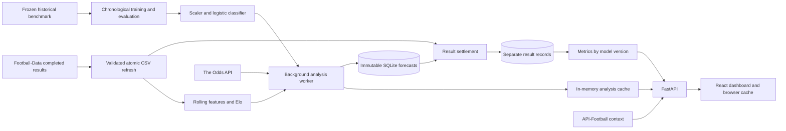

# System architecture

## Scope and current behavior

The product combines fixtures, market probabilities, an independent trained
classifier and supporting football context. It is a single Python backend and
a separately deployed React frontend. Predictions are numerical model outputs;
the current analysis narrative is deterministic text. Generative explanations
are not implemented.

## Data paths

### Offline training

`prediction.bootstrap` prepares exactly nine benchmark files (2016/17–2024/25).
`pipeline.train` constructs features from earlier-day results, fits a scaler and
classifier on training rows, selects regularization on validation rows, and reports
held-out metrics. The artifact includes ordered features and training metadata.
Serving history is maintained separately to avoid silently extending the benchmark.

### Serving

The background worker periodically obtains upcoming fixtures and odds, runs the
legacy market normalization pipeline, then attaches a learned forecast. Ready
learned forecasts replace the top-level model favorite and discrepancies. When
unavailable, compatibility fields retain the legacy baseline; clients must check
`learned_prediction.status` and must not label those compatibility numbers as an
independent prediction.

`PredictionService` caches loaded artifacts/results using file modification
signatures. Each inference reconstructs team state using results before the current
UTC day, calculates features for the fixture date and returns three probabilities.
Explicit aliases map provider names to CSV names; no fuzzy team matching occurs.
Model hashes identify exact artifacts; source hashes identify history contents.

The service withholds forecasts for started matches, missing/incompatible artifacts,
unknown teams, fewer than five historical matches or either team's latest match
being more than 35 days old. Long summer breaks and some promoted teams therefore
have no prediction. Status and dates are part of the response.

### Prospective evidence and results

`SnapshotStore` inserts only before kickoff. Its primary key is fixture identity
(provider team names and kickoff timestamp) plus model version. `INSERT OR IGNORE`
preserves the first snapshot for that key; refreshes never update its JSON payload.
A separate `prediction_results` table records the settled result and source hash.
Changing results never rewrites the original forecast.

Settlement joins completed CSV results by UTC kickoff date and explicitly normalized
home/away names. Same-day results are conservatively deferred until the next UTC day.
Unmatched or rescheduled fixtures remain pending. A changed kickoff creates a
different fixture key; there is no automatic reassignment to a postponed match.
Source corrections that disagree with settled scores are counted as conflicts;
they require review instead of silent overwrites.

Metrics are grouped by model version. All valid settled model forecasts contribute
to the model score; comparisons to the market use only forecasts with valid model
and market probabilities, on exactly the same fixtures. No settled examples means
null scores, not a fabricated zero accuracy. See [model design](MODEL.md).

## API boundaries

- `/predict` accepts team names and resolves kickoff from provider-backed fixtures.
- `/analyze-all` serves cached analysis; cold computation runs in a worker thread.
- `/model-metrics` is a read-only, thread-pooled endpoint over learned snapshots.
- Legacy `/predictions`, `/metrics` and `/validate` remain separate.

The prediction endpoint does not accept client-supplied outcomes or kickoff dates.
There is no public endpoint for writing settlements; the background worker and
operator CLI use validated local result files.

## Frontend behavior

The dashboard initially renders browser-cached or bundled sample matches. These
are labeled as unconfirmed until the API responds. It fetches analysis and prospective
metrics every minute. A match comparison shows home/draw/away probabilities and
model-minus-market differences in percentage points, alongside model/history dates.
Expired predictions (12 hours) and started fixtures are withheld in the UI. A
separate performance panel labels live results separately from the offline benchmark.

## Storage and deployment decisions

SQLite suits a single process and a modest Premier League workload. Connections
are scoped and closed explicitly. Snapshots and settlements are stored separately
from the old `predictions.db`; local pre-existing data is not migrated or rewritten.
The analysis cache is process-local; this version is designed for one backend
instance. Multiple workers would duplicate caches and background jobs.

Model/data artifacts can be reproduced at build time. Prospective evidence cannot
be recreated after matches, so its database must use persistent storage. Render's
default filesystem is ephemeral; [the runbook](DEPLOYMENT.md) covers the required
hosting configuration. The repository does not create paid resources automatically.

## Known limits and future work

The old synchronous sports API calls in some async routes remain a latency concern;
the new cold batch inference and learned metrics avoid blocking the event loop.
Historical context uses legacy season fallbacks and is not part of the ML features.
There is no user authentication, durable distributed job queue, automated conflict
resolution, calibration monitor or generative explanation service yet.

The future LLM layer should consume verified features, model outputs and dated
evidence. It must not invent injuries or independently change probabilities.
